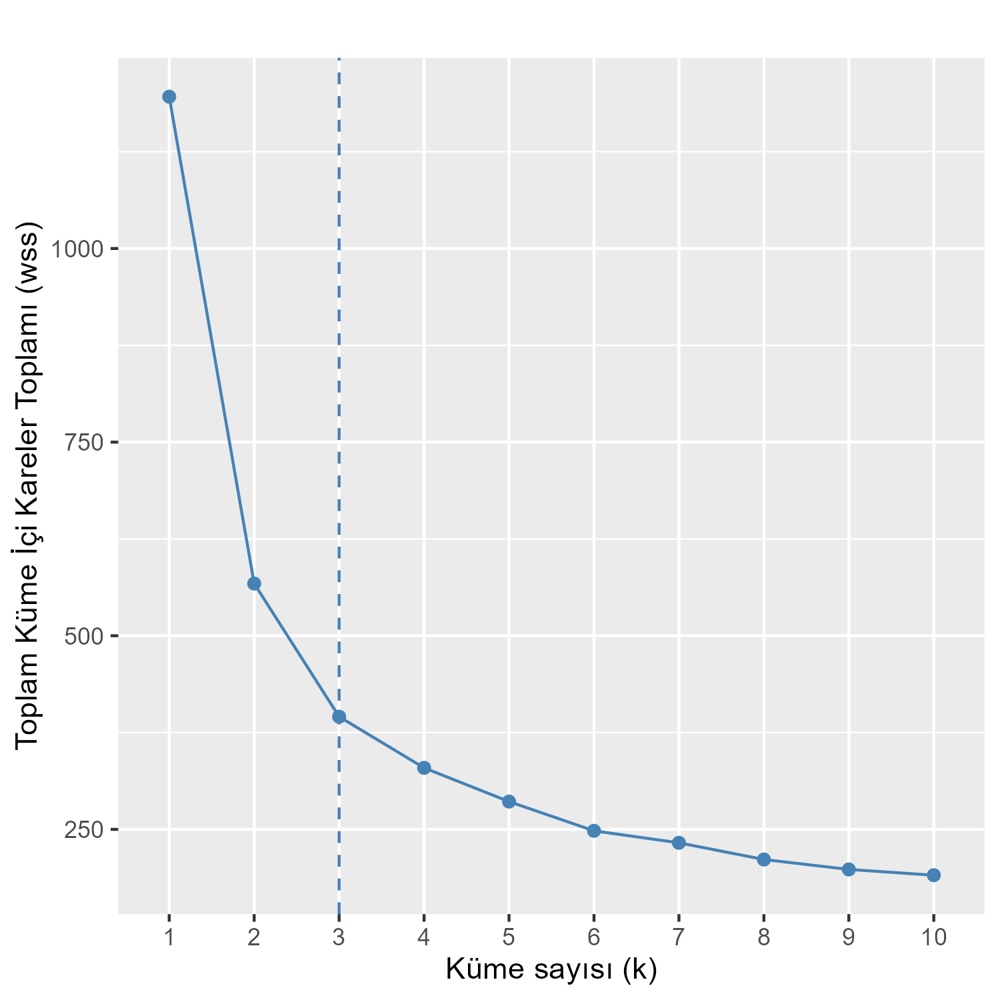
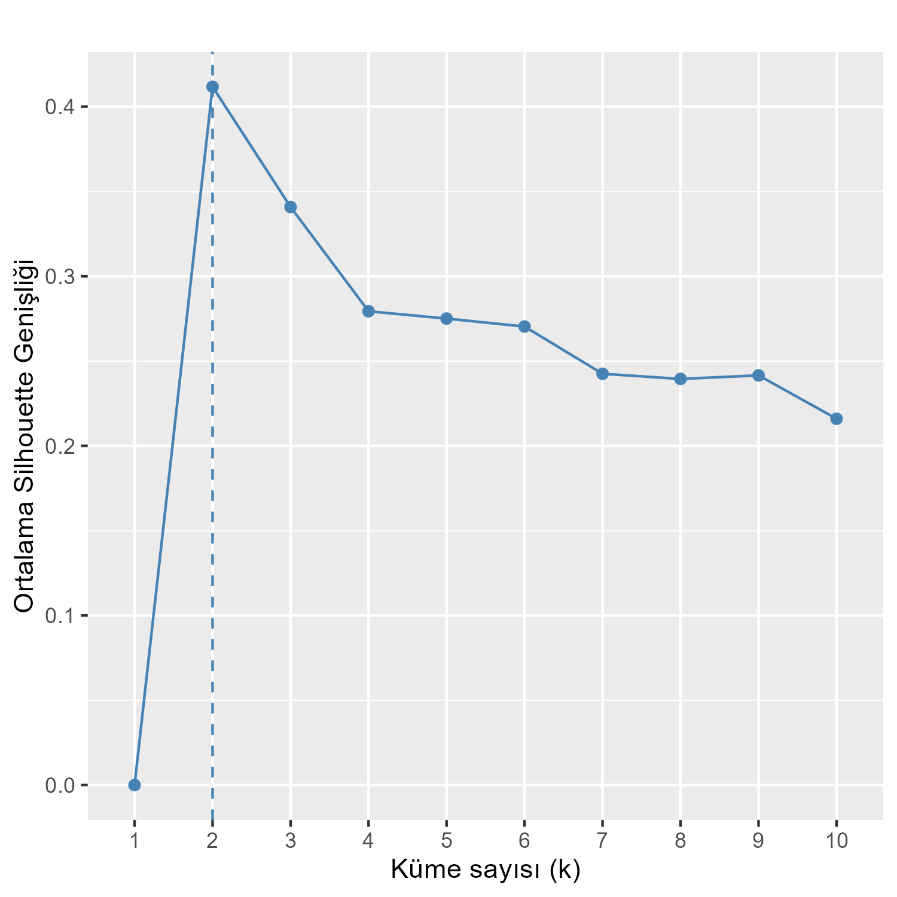
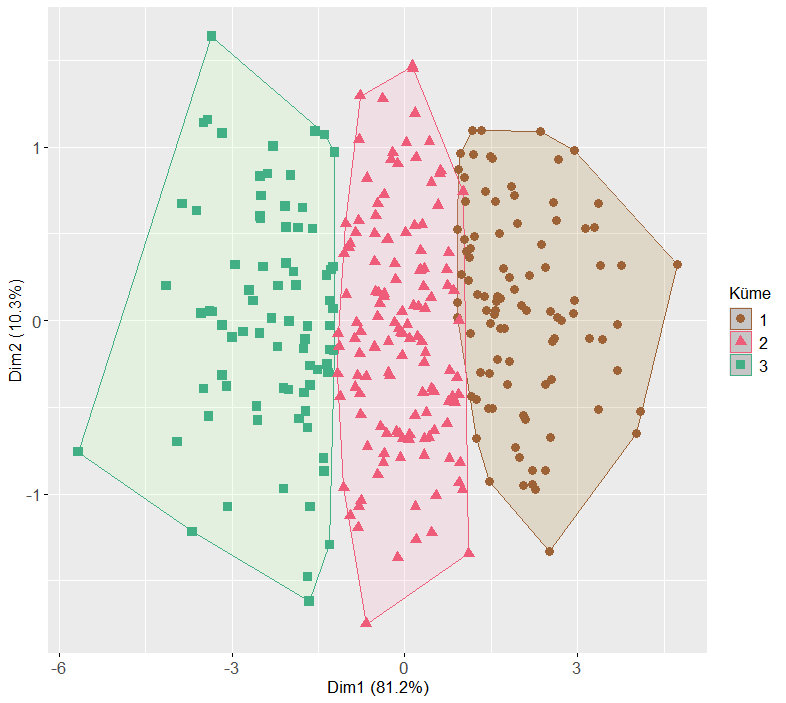

# Sainfoin Synthetic Dataset for Developmental Stage Prediction

**Generation of a Synthetic Dataset Based on Reference Chemical
Composition Values for Machine Learning-Based Prediction of Sainfoin
(*Onobrychis viciifolia*) Developmental Stages**

**Authors:** Mahmut AYDIN and Muhammet ŞAKİROĞLU

------------------------------------------------------------------------

## Overview

Sainfoin (*Onobrychis viciifolia*) is an important forage crop whose
chemical composition and forage quality change across developmental
stages. This repository provides a synthetic dataset generated from
chemical-composition reference values reported in the literature. It is
intended to support exploratory analysis and the development of
machine-learning workflows for classifying sainfoin developmental
stages.

The dataset contains **300 synthetic observations**, with **100
observations for each of three developmental stages**:

-   Vegetative
-   Flowering
-   Late maturity

Four chemical-composition variables are included:

  Variable   Description
  ---------- -------------------------
  `CP`       Crude protein
  `NDF`      Neutral detergent fiber
  `ADF`      Acid detergent fiber
  `CT`       Condensed tannins

The reference means and standard errors used for data generation were
taken from Bal et al. (2006). The generation procedure also considers
relationships among the chemical-composition variables.

## Dataset

The dataset is available in [`synthetic_data.csv`](synthetic_data.csv).

The data are **synthetic**, not direct field or laboratory measurements.
They were generated to represent statistical patterns based on published
reference values and should be used with that distinction in mind.

## Data generation

The synthetic observations were generated in the R programming
environment using the reference chemical-composition values reported for
different maturity stages.

The standard deviations used during generation were estimated from the
reported standard errors of the means (SEM). Because the sample size of
the reference study could not be established from the information
available for this procedure, **n = 182 was adopted as an assumption**
when estimating standard deviations. This value is therefore a
generation assumption, not a sample size reported by the reference
study.

The data-generation script is:

-   [`synthetic_data_creator.R`](synthetic_data_creator.R)

## Data exploration and clustering

The repository includes scripts and figures for visual inspection and
clustering analysis.

### Chemical-component distributions and relationships

The pair-plot visualization presents the distributions of CP, NDF, ADF,
and CT, their pairwise relationships, and their patterns across
developmental stages.

### Selecting the number of clusters

The Elbow and Silhouette methods were used to examine candidate cluster
numbers. In the reported analysis, the Elbow method suggested **k = 3**,
whereas the highest average Silhouette value was obtained at **k = 2**.
Both findings are retained when interpreting the clustering structure.

**Elbow method**

**Silhouette method**

### K-means clustering

K-means clustering was used to inspect the structure of the synthetic
observations. In the two-dimensional representation, the first and
second dimensions explained 81.2% and 10.3% of the variance,
respectively, accounting for 91.5% cumulatively.

The visual clusters should not, on their own, be interpreted as proof
that the synthetic clusters fully represent biological developmental
stages.

## Machine-learning classification

Three classification algorithms were evaluated using the synthetic
dataset:

-   Support Vector Machine (SVM)
-   Random Forest (RF)
-   Extreme Gradient Boosting (XGBoost)

The dataset was divided into training (80%) and test (20%) subsets using
stratified sampling. The random seed was set to 42. The reported
performance on the synthetic test subset is summarized below.

  -----------------------------------------------------------------------
  Model             Accuracy       F1-score      Precision Recall (macro)
                                    (macro)        (macro) 
  ----------- -------------- -------------- -------------- --------------
  SVM                  0.833          0.836          0.843          0.833

  Random               0.750          0.751          0.755          0.750
  Forest                                                   

  XGBoost              0.833          0.827          0.827          0.827
  -----------------------------------------------------------------------

These values describe model performance on this synthetic dataset only.
They should not be interpreted as estimates of performance on
independent field or laboratory samples.

## Repository contents

All files are located in the repository root directory.

  ---------------------------------------------------------------------------------
  File                                          Description
  --------------------------------------------- -----------------------------------
  `synthetic_data.csv`                          Synthetic dataset containing 300
                                                observations

  `synthetic_data_creator.R`                    R script for generating the
                                                synthetic dataset

  `elbow_method_on_synthetic_data.R`            R script for the Elbow analysis

  `elbow_method_on_synthetic_data.png`          Elbow-method figure

  `silhouette_method_on_synthetic_data.R`       R script for the Silhouette
                                                analysis

  `silhouette_method_on_synthetic_data.png`     Silhouette-method figure

  `kmeans-clustering_on_synthetic_data.R`       R script for K-means clustering

  `kmeans-clustering_on_synthetic_data.png`     K-means clustering figure

  `scatter_plot_n_182_cor_300dpi_colored.png`   Pair-plot of chemical-component
                                                distributions and relationships
  ---------------------------------------------------------------------------------

## Repository

<https://github.com/mahmutt/sainfoin_synthetic_data>

## Authors

-   **Mahmut AYDIN**
-   **Muhammet ŞAKİROĞLU**
