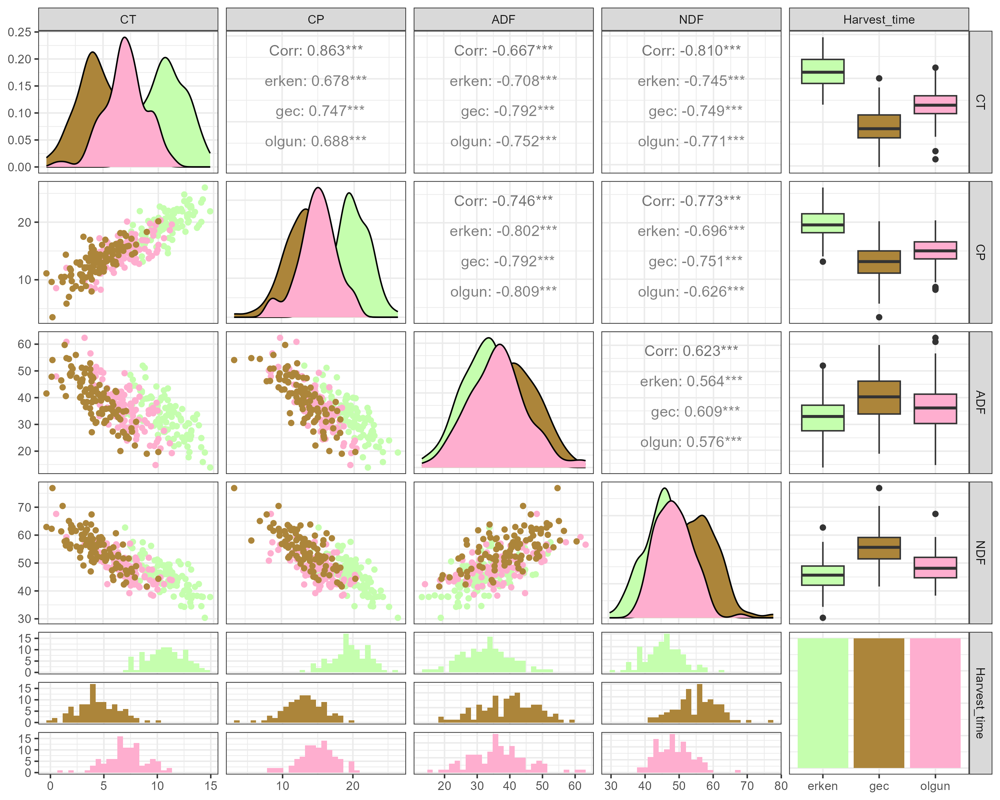
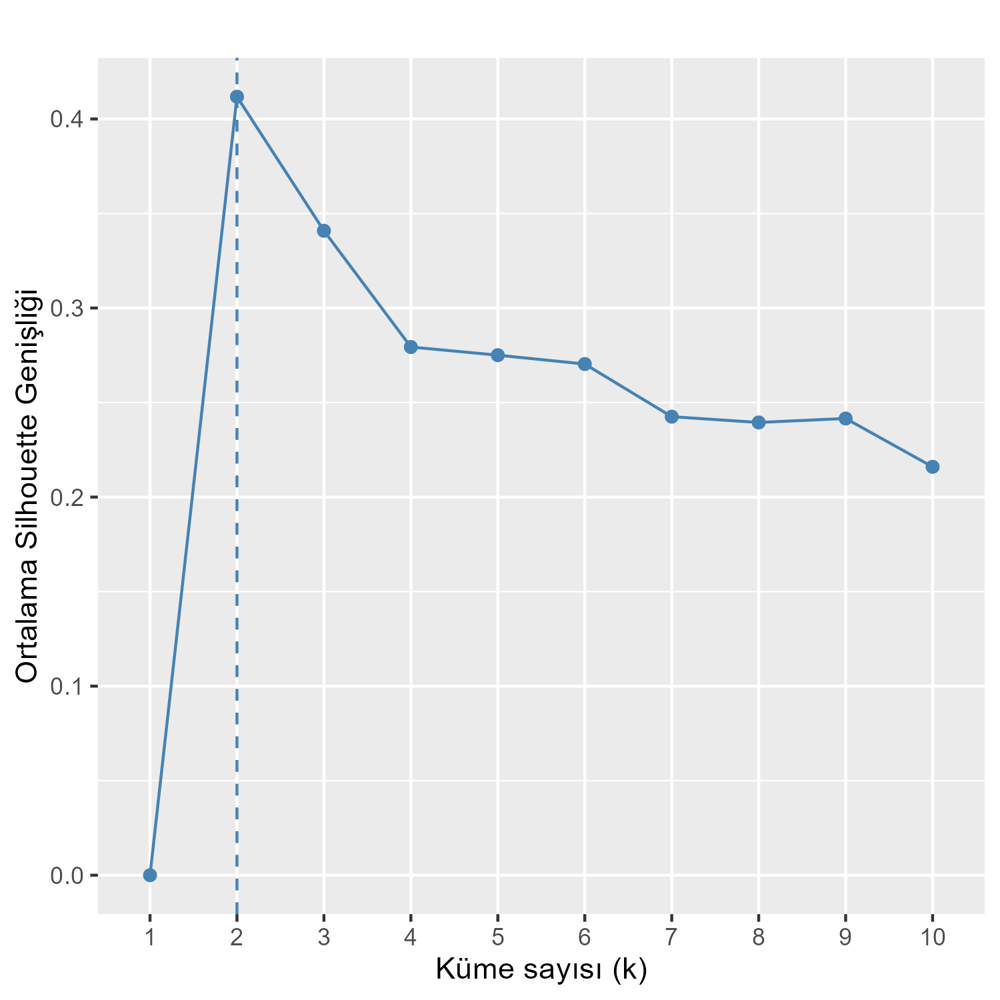

# Sainfoin Synthetic Dataset for Developmental Stage Prediction

A synthetic dataset generated from reference chemical-composition values, and
R code for clustering and machine-learning classification of sainfoin
(*Onobrychis viciifolia* Scop.) developmental stages.

---

## Overview

Sainfoin (*Onobrychis viciifolia* Scop.) is an important forage crop whose
chemical composition and forage quality change across developmental stages.
This repository provides a synthetic dataset generated from
chemical-composition reference values reported in the literature, together
with the code used to explore it and to train classifiers that assign field
samples to developmental stages.

The dataset contains **300 synthetic observations**, with **100 observations
for each of three developmental stages**:

| Label in the data | Developmental stage |
| --- | --- |
| `early` | Vegetative |
| `mature` | Flowering |
| `late` | Late maturity |

Four chemical-composition variables are included:

| Variable | Description |
| --- | --- |
| `CP` | Crude protein (%) |
| `NDF` | Neutral detergent fiber (%) |
| `ADF` | Acid detergent fiber (%) |
| `CT` | Condensed tannins (%) |

The data are **synthetic**, not direct field or laboratory measurements. They
were generated to represent statistical patterns based on published reference
values and should be used with that distinction in mind.

## Repository structure

```
data/
  synthetic_data.csv          300 synthetic observations
  field_samples.csv           laboratory values of 23 field samples (ADF, NDF, CP, CT)
R/
  synthetic_data_creator.R    generates data/synthetic_data.csv
  elbow_method_on_synthetic_data.R
  silhouette_method_on_synthetic_data.R
  kmeans-clustering_on_synthetic_data.R
  svm_training.R              trains and evaluates SVM
  rf_training.R               trains and evaluates Random Forest
  xgboost_training.R          trains and evaluates XGBoost
  svm_predict.R               predicts the stage of the field samples with SVM
  rf_predict.R                predicts the stage of the field samples with RF
  xgboost_predict.R           predicts the stage of the field samples with XGBoost
figures/                      figures produced by the scripts (PNG, 300 dpi)
ml_models/                    trained models and scaling parameters
sainfoin_synthetic_data.Rproj RStudio project file
```

## How to run

All scripts use paths relative to the repository root. Open
`sainfoin_synthetic_data.Rproj` in RStudio (or set the working directory to
the repository root) and run the scripts in this order:

1. `R/synthetic_data_creator.R` (optional; the dataset is already provided)
2. `R/elbow_method_on_synthetic_data.R`, `R/silhouette_method_on_synthetic_data.R`,
   `R/kmeans-clustering_on_synthetic_data.R`
3. `R/svm_training.R`, `R/rf_training.R`, `R/xgboost_training.R`
   (each saves its model to `ml_models/`)
4. `R/svm_predict.R`, `R/rf_predict.R`, `R/xgboost_predict.R`
   (each loads its model from `ml_models/` and classifies `data/field_samples.csv`)

## Data generation

| Item | Setting |
| --- | --- |
| Size | 300 observations (100 per stage) |
| Reference values | Stage means and standard errors of the means (SEM) of CP, NDF, ADF and CT reported by Bal et al. (2006) |
| Distribution | Multivariate normal (`MASS::mvrnorm`) with stage-specific means and a covariance matrix common to all stages |
| Spread | SD = SEM × √n, with **n = 182 assumed** |
| Correlations | **Assumed** common correlation matrix among NDF, ADF, CP and CT, adjusted to the nearest positive-definite matrix (`Matrix::nearPD`) |
| Random seed | `set.seed(123)` |

**Assumptions**

- **Sample size (n = 182).** The reference study reports SEM, but its sample
  size could not be established from the information available. n = 182 was
  therefore adopted as an assumption to convert SEM into standard deviations.
  It is a generation assumption, not a sample size reported by the reference
  study.
- **Correlation matrix.** No correlation matrix was reported in the reference
  study. The correlations were set to reflect the known direction of the
  relationships between fibre, protein and condensed tannin in forage legumes:
  NDF and ADF are positively correlated, both are negatively correlated with
  CP and CT, and CP and CT are positively correlated. The same correlation
  structure was assumed for all three stages. The signs of all assumed
  correlations agree with those observed in the 23 field samples in
  `data/field_samples.csv`.
- **Unbounded distribution.** Because normal distributions are unbounded, a
  few synthetic values fall outside the physically possible range (e.g. one
  slightly negative CT value). They were retained.

## Data exploration and clustering

### Chemical-component distributions and relationships

The pair-plot visualization presents the distributions of CP, NDF, ADF, and CT,
their pairwise relationships, and their patterns across developmental stages.



### Selecting the number of clusters

The Elbow and Silhouette methods were used to examine candidate cluster
numbers. The Elbow method suggested **k = 3**, whereas the highest average
Silhouette value was obtained at **k = 2**. Both findings are retained when
interpreting the clustering structure.

**Elbow method**


**Silhouette method**



### K-means clustering

K-means clustering (k = 3, `nstart = 25`, `set.seed(123)`) was used to inspect
the structure of the synthetic observations. In the two-dimensional
representation, the first and second dimensions explained 81.2% and 10.3% of
the variance, respectively, accounting for 91.5% cumulatively.


The visual clusters should not, on their own, be interpreted as proof that the
synthetic clusters fully represent biological developmental stages.

## Machine-learning classification

Three classification algorithms were trained on the synthetic dataset:

| Model | Script | Settings |
| --- | --- | --- |
| Support Vector Machine (SVM) | `R/svm_training.R` | RBF kernel, cost = 1; features centred and scaled on the training set |
| Random Forest (RF) | `R/rf_training.R` | 100 trees; unscaled features |
| Extreme Gradient Boosting (XGBoost) | `R/xgboost_training.R` | `multi:softmax`, 100 rounds, max_depth = 6, eta = 0.3; features centred and scaled on the training set |

The dataset was divided into training (80%) and test (20%) subsets with
`caret::createDataPartition` and random seed 42 (stratified by stage for SVM and
RF; by the numeric class code for XGBoost). The trained models were then used to
predict the developmental stage of the field samples in
`data/field_samples.csv`. The performance on the synthetic test subset is
summarized below (precision, recall and F1-score are macro-averaged).

| Model | Accuracy | F1-score (macro) | Precision (macro) | Recall (macro) |
| --- | --- | --- | --- | --- |
| SVM | 0.833 | 0.836 | 0.843 | 0.833 |
| Random Forest | 0.750 | 0.751 | 0.755 | 0.750 |
| XGBoost | 0.833 | 0.827 | 0.827 | 0.827 |

These values describe model performance on this synthetic dataset only. They
should not be interpreted as estimates of performance on independent field or
laboratory samples.

## Trained models

| File | Content | Created by |
| --- | --- | --- |
| `ml_models/svm_model_y.rds` | SVM model | `R/svm_training.R` |
| `ml_models/svm_preproc_y.rds` | Scaling parameters for SVM | `R/svm_training.R` |
| `ml_models/random_forest_model_y.rds` | Random Forest model | `R/rf_training.R` |
| `ml_models/xgboost_model_y.model` | XGBoost model | `R/xgboost_training.R` |
| `ml_models/xgboost_model_y.rds` | Scaling parameters for XGBoost | `R/xgboost_training.R` |

## Reference

Bal MA, Ozturk D, Aydin R, Erol A, Ozkan CO, Ata M, et al. Nutritive value of
sainfoin (*Onobrychis viciaefolia*) harvested at different maturity stages.
*Pakistan Journal of Biological Sciences*. 2006;9(2): 205–209.
doi:[10.3923/pjbs.2006.205.209](https://doi.org/10.3923/pjbs.2006.205.209)

## Archived version

Archived on Zenodo: DOI `[to be added]`
