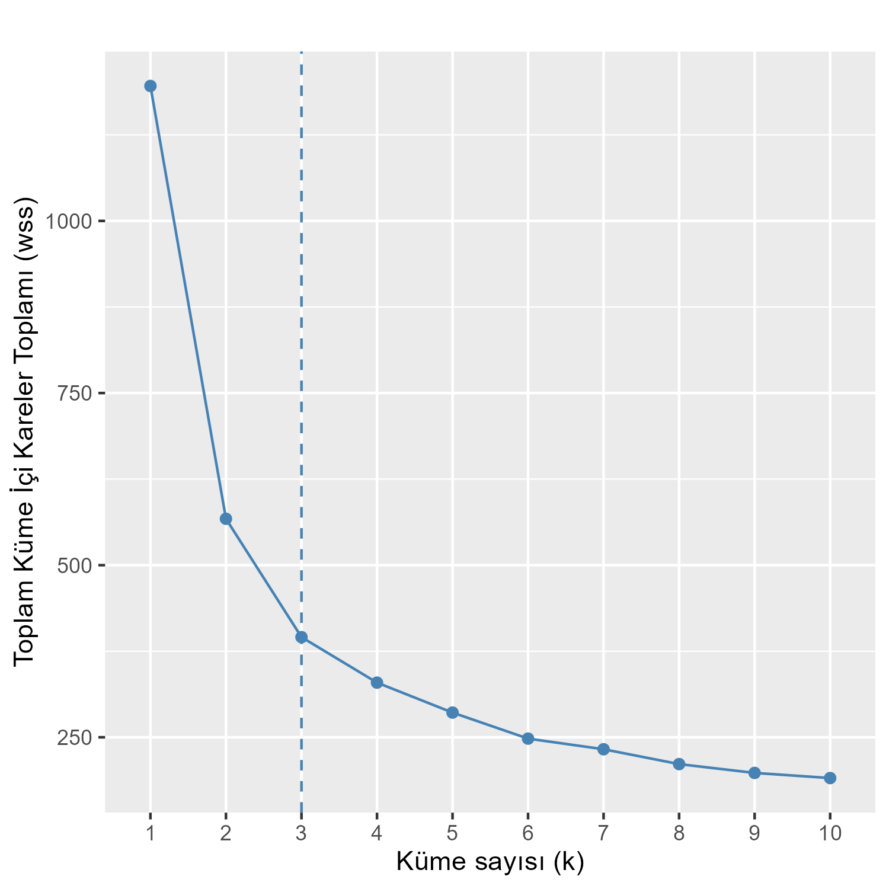
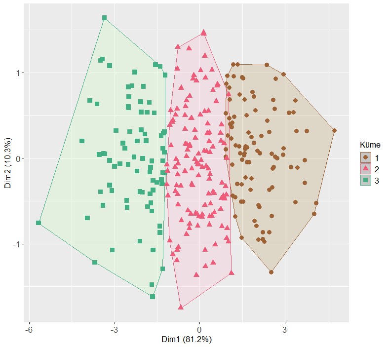

# Sainfoin Maturity-Stage Classification: Data and Code

Data and code for classifying the maturity stage of sainfoin
(*Onobrychis viciifolia* Scop.) in two parts:

1. **Laboratory part (R):** a synthetic reference dataset generated from
   published chemical-composition values, and the clustering and
   machine-learning models used to assign field samples to maturity stages.
2. **Image part (Python, Google Colab):** notebooks that train six
   transfer-learning models to classify UAV RGB images into the same stages.

---

## Repository structure

```
data/
  synthetic_data.csv          300 synthetic observations
  field_samples.csv           laboratory values of 23 field samples (ADF, NDF, CP, CT)
R/
  synthetic_data_creator.R    generates data/synthetic_data.csv
  elbow_method_on_synthetic_data.R
  silhouette_method_on_synthetic_data.R
  kmeans-clustering_on_synthetic_data.R
  svm_training.R              trains and evaluates SVM
  rf_training.R               trains and evaluates Random Forest
  xgboost_training.R          trains and evaluates XGBoost
  svm_predict.R               predicts the stage of the field samples with SVM
  rf_predict.R                predicts the stage of the field samples with RF
  xgboost_predict.R           predicts the stage of the field samples with XGBoost
notebooks/                    Colab notebooks of the six deep-learning models
figures/                      figures produced by the R scripts (PNG, 300 dpi)
ml_models/                    trained R models and scaling parameters
sainfoin_synthetic_data.Rproj RStudio project file
```

## Maturity stages

| Label | Developmental stage |
| --- | --- |
| `early` | Vegetative |
| `mature` | Flowering |
| `late` | Late maturity |

---

# Part 1 – Laboratory data (R)

## Synthetic dataset

The dataset contains **300 synthetic observations** (100 per stage) with four
chemical-composition variables:

| Variable | Description |
| --- | --- |
| `CP` | Crude protein (%) |
| `NDF` | Neutral detergent fiber (%) |
| `ADF` | Acid detergent fiber (%) |
| `CT` | Condensed tannins (%) |

The data are **synthetic**, not direct field or laboratory measurements. They
were generated to represent statistical patterns based on published reference
values and should be used with that distinction in mind.

### Data generation

| Item | Setting |
| --- | --- |
| Size | 300 observations (100 per stage) |
| Reference values | Stage means and standard errors of the means (SEM) of CP, NDF, ADF and CT reported by Bal et al. (2006) |
| Distribution | Multivariate normal (`MASS::mvrnorm`) with stage-specific means and a covariance matrix common to all stages |
| Spread | SD = SEM × √n, with **n = 182 assumed** |
| Correlations | **Assumed** common correlation matrix among NDF, ADF, CP and CT, adjusted to the nearest positive-definite matrix (`Matrix::nearPD`) |
| Random seed | `set.seed(123)` |

**Assumptions**

- **Sample size (n = 182).** The reference study reports SEM, but its sample
  size could not be established from the information available. n = 182 was
  therefore adopted as an assumption to convert SEM into standard deviations.
  It is a generation assumption, not a sample size reported by the reference
  study.
- **Correlation matrix.** No correlation matrix was reported in the reference
  study. The correlations were set to reflect the known direction of the
  relationships between fibre, protein and condensed tannin in forage legumes:
  NDF and ADF are positively correlated, both are negatively correlated with
  CP and CT, and CP and CT are positively correlated. The same correlation
  structure was assumed for all three stages. The signs of all assumed
  correlations agree with those observed in the 23 field samples in
  `data/field_samples.csv`.
- **Unbounded distribution.** Because normal distributions are unbounded, a
  few synthetic values fall outside the physically possible range (e.g. one
  slightly negative CT value). They were retained.

## How to run (R)

All scripts use paths relative to the repository root. Open
`sainfoin_synthetic_data.Rproj` in RStudio (or set the working directory to
the repository root) and run the scripts in this order:

1. `R/synthetic_data_creator.R` (optional; the dataset is already provided)
2. `R/elbow_method_on_synthetic_data.R`, `R/silhouette_method_on_synthetic_data.R`,
   `R/kmeans-clustering_on_synthetic_data.R`
3. `R/svm_training.R`, `R/rf_training.R`, `R/xgboost_training.R`
   (each saves its model to `ml_models/`)
4. `R/svm_predict.R`, `R/rf_predict.R`, `R/xgboost_predict.R`
   (each loads its model from `ml_models/` and classifies `data/field_samples.csv`)

## Data exploration and clustering

### Chemical-component distributions and relationships


### Selecting the number of clusters

The Elbow method suggested **k = 3**, whereas the highest average Silhouette
value was obtained at **k = 2**. Both findings are retained when interpreting
the clustering structure.

**Elbow method**



**Silhouette method**


### K-means clustering

K-means clustering (k = 3, `nstart = 25`, `set.seed(123)`). In the
two-dimensional representation, the first and second dimensions explained
81.2% and 10.3% of the variance (91.5% cumulatively).



The visual clusters should not, on their own, be interpreted as proof that the
synthetic clusters fully represent biological developmental stages.

## Machine-learning classification

| Model | Script | Settings |
| --- | --- | --- |
| Support Vector Machine (SVM) | `R/svm_training.R` | RBF kernel, cost = 1; features centred and scaled on the training set |
| Random Forest (RF) | `R/rf_training.R` | 100 trees; unscaled features |
| Extreme Gradient Boosting (XGBoost) | `R/xgboost_training.R` | `multi:softmax`, 100 rounds, max_depth = 6, eta = 0.3; features centred and scaled on the training set |

The dataset was divided into training (80%) and test (20%) subsets with
`caret::createDataPartition` and random seed 42 (stratified by stage for SVM and
RF; by the numeric class code for XGBoost). The trained models were then used to
predict the stage of the field samples in `data/field_samples.csv`.
Performance on the synthetic test subset (precision, recall and F1-score are
macro-averaged):

| Model | Accuracy | F1-score | Precision | Recall |
| --- | --- | --- | --- | --- |
| SVM | 0.833 | 0.836 | 0.843 | 0.833 |
| Random Forest | 0.750 | 0.751 | 0.755 | 0.750 |
| XGBoost | 0.833 | 0.827 | 0.827 | 0.827 |

These values describe performance on the synthetic dataset only and should not
be interpreted as estimates of performance on independent field or laboratory
samples.

### Trained models

| File | Content | Created by |
| --- | --- | --- |
| `ml_models/svm_model_y.rds` | SVM model | `R/svm_training.R` |
| `ml_models/svm_preproc_y.rds` | Scaling parameters for SVM | `R/svm_training.R` |
| `ml_models/random_forest_model_y.rds` | Random Forest model | `R/rf_training.R` |
| `ml_models/xgboost_model_y.model` | XGBoost model | `R/xgboost_training.R` |
| `ml_models/xgboost_model_y.rds` | Scaling parameters for XGBoost | `R/xgboost_training.R` |

---

# Part 2 – UAV image classification (Python)

## Image dataset

The labelled UAV RGB images (2,726 images; 2,188 training, 269 validation and
269 test) and a metadata file giving the split, label, sample, session, date
and field of every image are archived on Zenodo:
<https://doi.org/10.5281/zenodo.24484581>.

Class folders are named in Turkish: `erken` = early, `gec` = late,
`olgun` = mature.

## Notebooks

| Notebook | Input size | Training strategy | Test accuracy* |
| --- | --- | --- | --- |
| `VGG16_sainfoin_maturity.ipynb` | 224 × 224 | frozen backbone, then fine-tuning of the last 5 layers | 0.918 |
| `VGG19_sainfoin_maturity.ipynb` | 224 × 224 | frozen backbone, then fine-tuning of the last 5 layers | 0.918 |
| `ResNet50_sainfoin_maturity.ipynb` | 224 × 224 | end-to-end fine-tuning (learning rate 1e-5) | 0.937 |
| `DenseNet201_sainfoin_maturity.ipynb` | 224 × 224 | frozen backbone | 0.881 |
| `InceptionV3_sainfoin_maturity.ipynb` | 299 × 299 | frozen backbone, then fine-tuning of the last 50 layers | 0.877 |
| `EfficientNetB7_sainfoin_maturity.ipynb` | 600 × 600 | end-to-end fine-tuning (learning rate 1e-5) | 0.970 |

\* On the 269 test images of the published split. All other settings (batch
size, augmentation, dropout, learning rates, callbacks and class weights) are
given in each notebook.

## How to run (Google Colab)

1. Download the image dataset from Zenodo and place the `train/`,
   `validation/` and `test/` folders in Google Drive.
2. Open a notebook in Google Colab and select a GPU runtime.
3. Set `DATA_DIR` (and, if needed, `MODEL_DIR`) in the configuration cell.
4. Run all cells.

The notebooks use TensorFlow/Keras, scikit-learn, matplotlib and seaborn,
which are available in the standard Colab GPU runtime (install TensorFlow with
`pip install tensorflow` if it is missing).

## Notes

- The outputs stored in the notebooks are those of the original runs. Comments
  and labels were translated into English afterwards, so some printed messages
  and figure labels in the stored outputs are in Turkish. No settings were
  changed.
- Each model was trained once. Fixed seeds were used for shuffling the
  training data, but no global random seed was set, so repeated runs may give
  slightly different results.
- The images were split into training, validation and test sets at the image
  level. Images from the same acquisition session can therefore occur in more
  than one subset, and the reported accuracies describe discrimination within
  the sampled sessions; they may overestimate performance on images from new
  dates or fields. The session of every image is given in the Zenodo metadata
  file, so grouped (e.g. leave-one-session-out) evaluations can be carried out
  directly.

---

## Reference

Bal MA, Ozturk D, Aydin R, Erol A, Ozkan CO, Ata M, et al. Nutritive value of
sainfoin (*Onobrychis viciaefolia*) harvested at different maturity stages.
*Pakistan Journal of Biological Sciences*. 2006;9(2): 205–209.
doi:[10.3923/pjbs.2006.205.209](https://doi.org/10.3923/pjbs.2006.205.209)

## Archived versions

- Code and laboratory data: <https://doi.org/10.5281/zenodo.24541381> (version 1.1.0,
  used in the article); all versions: <https://doi.org/10.5281/zenodo.24482345>
- UAV image dataset: <https://doi.org/10.5281/zenodo.24484581>
